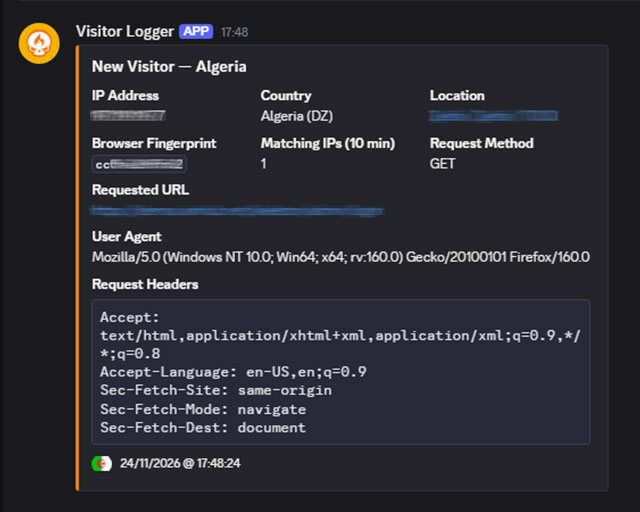

# CiSkeleton Plugin — Discord Visitor Logger

Discord Visitor Logger is a **[CiSkeleton](https://github.com/ciskeleton)** plugin that sends Discord notifications when a new public IP address visits your application.

  
  

  

Each notification is delivered as a Discord embed containing the visitor's IP address, approximate geolocation, requested URL, browser user agent, and selected request headers.

## Features

- **Discord notifications** — Send visitor notifications through a configurable Discord webhook.
- **Geolocation** — Include the visitor's country, region, city, and postal code when available.
- **Map links** — View the approximate visitor location on Google Maps when coordinates are available.
- **Browser fingerprinting** — Identify groups of distinct IP addresses sharing the same browser fingerprint within a configurable time window.
- **Suspicious traffic detection** — Flag potential distributed automated traffic when the configured fingerprint threshold is reached.
- **Optional automatic banning** — Temporarily or permanently ban newly detected suspicious IP addresses through CiSkeleton's firewall.
- **Duplicate prevention** — Cache previously recorded IP addresses to avoid repeatedly notifying Discord about the same address.
- **Lightweight** — Uses CiSkeleton's built-in HTTP client and storage system.

## Requirements

- CiSkeleton
- A Discord incoming webhook
- Outbound HTTP/HTTPS connectivity for the webhook and geolocation service

## Configuration

Navigate to **Settings > Other Settings > Discord** (`admin/settings/discord`) to configure the plugin.

Available settings:

| Setting | Description | Default |
|---|---|---|
| Discord Webhook URL | Webhook used to send visitor notifications to Discord. | Empty |
| Automatically Ban Suspicious IPs | Enable or disable automatic IP banning when suspicious traffic is detected. | No |
| Fingerprint IP Threshold | Number of distinct IP addresses sharing the same browser fingerprint within 10 minutes before traffic is considered suspicious. | 12 |
| Temporary Ban Duration | Number of hours a suspicious IP address remains banned. Set to `0` for a permanent ban. | 1 hour |

Create an incoming webhook in your Discord server and enter its URL in the corresponding setting.

**Keep your webhook URL private.** Anyone who obtains it may be able to send messages to the associated Discord channel.

Automatic banning is disabled by default. When enabled, only the newly arriving IP address that reaches the configured fingerprint threshold is banned. Previously detected IP addresses are not retroactively banned.

## How It Works

When a request reaches the application, the plugin:

1. Ignores requests without a user agent and filters common bots and automated clients.
2. Rejects invalid, private, reserved, and loopback IP addresses.
3. Checks the visitor cache for the IP address.
4. Builds a browser fingerprint from selected request headers.
5. Checks whether other recently recorded IP addresses share the same fingerprint.
6. Retrieves approximate geolocation information for previously unseen IP addresses.
7. Sends a notification to Discord through the configured webhook.
8. Records the IP address after a successful notification.

When the number of matching IP addresses reaches the configured threshold within 10 minutes, the traffic is flagged as suspicious. If automatic banning is enabled, the newly arriving IP address is banned for the configured duration.

Previously recorded IP addresses are not notified again unless their cache entries are removed.

## Privacy

This plugin processes visitor IP addresses, browser user-agent strings, and selected request headers. It may send them, together with the requested URL and approximate location, to Discord.

Browser fingerprinting is based on HTTP request headers and is used to correlate visitors sharing similar browser configurations. It does not uniquely identify a device or prove that traffic is automated.

Geolocation is approximate and may be unavailable or inaccurate. IP addresses identify network endpoints, not necessarily individual people.

The plugin uses an external geolocation service to obtain location information. Review that service's terms and privacy policy before deploying the plugin, particularly on commercial websites.

Website operators are responsible for ensuring that their use of this plugin complies with applicable privacy laws and their own privacy policies.

## License

MIT License. See [LICENSE](LICENSE.md) for details.

---

  <a href="https://github.com/ciskeleton">CiSkeleton</a> is created, developed, and maintained by <a href="https://github.com/bkader">Kader Bouyakoub</a>, trading as <a href="https://github.com/ianhubnet">Ianhub</a>.

