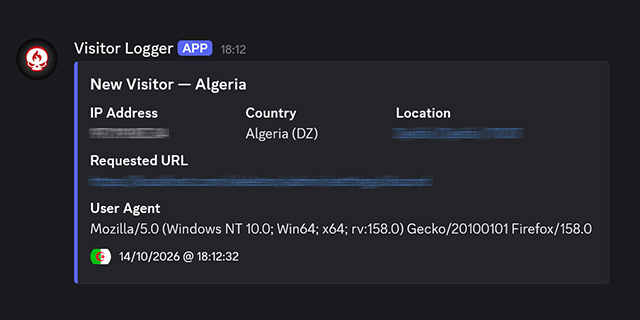

# CiSkeleton Plugin — Discord Visitor Logger

Discord Visitor Logger is a **[CiSkeleton](https://github.com/ciskeleton)** plugin that sends Discord notifications when a new public IP address visits your application.

  

Each notification is delivered as a Discord embed containing the visitor's IP address, approximate geolocation, requested URL, and browser user agent.

## Features

- **Discord notifications** — Send visitor notifications through a configurable Discord webhook.
- **Geolocation** — Include the visitor's country, region, city, and postal code when available.
- **Map links** — View the approximate visitor location on Google Maps when coordinates are available.
- **Duplicate prevention** — Cache previously recorded IP addresses to avoid repeatedly notifying Discord about the same address.
- **Lightweight** — Uses CiSkeleton's built-in HTTP client and storage system.

## Requirements

- CiSkeleton
- A Discord incoming webhook
- Outbound HTTP/HTTPS connectivity for the webhook and geolocation service

## Configuration

Navigate to **Settings > Other Settings > Discord** (`admin/settings/discord`) and configure the Discord webhook URL used by this plugin.

Create an incoming webhook in your Discord server and enter its URL in the corresponding setting.

**Keep your webhook URL private.** Anyone who obtains it may be able to send messages to the associated Discord channel.

## How It Works

When a request reaches the application, the plugin:

1. Ignores requests without a user agent and filters common bots and automated clients.
2. Rejects invalid, private, reserved, and loopback IP addresses.
3. Checks the visitor cache for the IP address.
4. Retrieves approximate geolocation information for previously unseen IP addresses.
5. Sends a notification to Discord through the configured webhook.
6. Records the IP address after a successful notification.

Previously recorded IP addresses are not notified again unless their cache entries are removed.

## Privacy

This plugin processes visitor IP addresses and user-agent strings and may send them, together with the requested URL and approximate location, to Discord.

Geolocation is approximate and may be unavailable or inaccurate. IP addresses identify network endpoints, not necessarily individual people.

The plugin uses an external geolocation service to obtain location information. Review that service's terms and privacy policy before deploying the plugin, particularly on commercial websites.

Website operators are responsible for ensuring that their use of this plugin complies with applicable privacy laws and their own privacy policies.

## License

MIT License. See [LICENSE](LICENSE.md) for details.

---

  <a href="https://github.com/ciskeleton">CiSkeleton</a> is created, developed, and maintained by <a href="https://github.com/bkader">Kader Bouyakoub</a>, trading as <a href="https://github.com/ianhubnet">Ianhub</a>.

